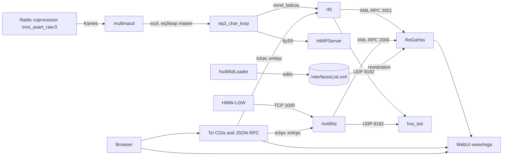

# System Data Flow
Sources: module docs and `integration-seams.md`. See that file for protocol detail and gaps.

## Data Sources
### File Systems
- Config: `/etc/config/rfd.conf`, `/etc/config/InterfacesList.xml`, `/etc/config/USERS.dat`, `/etc/config/crypttool.cfg`, `/etc/config/shadow`, `/etc/config/rc.d/*`, `/etc/bidcos/bidcos.conf`.
- State/flags: `/var/status/startupFinished`, `/var/status/hssLedReady`, `/var/status/hasLink`, `/var/status/hasIP`, `/var/status/hasInternet`, `/var/status/multimacd.status`, pid files `/var/run/eq3configd.pid`, `/var/run/ReGaHss.pid`, `/var/run/ssdpd.pid`, `/var/run/HMIPServer.pid`, `/var/run/multimacd.pid`, `/var/run/rfd.pid`, `/var/run/hs485dLoader.pid`, `/var/SESSIONS.dat`.
- Device descriptions: `firmware/` XML, `src/devicetypes` (generated via `build-tools/bidcos-devicetype-strip`, `GenerateDeviceTypes.cmake:15`).
### Hardware / Kernel
- Radio coprocessor `/dev/mxs_auart_raw.0` (frames: start 0xFD, escape 0xFC, CRC16 0x8005) read by `multimacd`; `eq3loop` char-device ioctls (magic 'L') create slave nodes `mmd_bidcos` (for rfd) and `ttyS0` (HmIP). `rfd` CCU interface reads `/dev/hss_rf`.
### External Interfaces
- XML-RPC: `hs485d` TCP 2000 (25 methods), `rfd` TCP 2001 (~50 methods, optional Unix socket); clients `SetInterfaceClock`, `hss_led`, `tclrpc`, `HSSManager`.
- UDP: loopback 8182 status datagrams from `HSSManager` (rfd/hs485d) to `hss_led`; unified LAN protocol over TCP (`libUnifiedLanComm`); `eq3configd` UDP identify/config.
- Control sockets: `/run/hss_led/control` (AF_UNIX SOCK_SEQPACKET).

## Critical Data Paths
### Radio device event to WebUI
1. Radio coprocessor frames -> `multimacd` (`MultimacManager.cpp`, `SubsystemManager.cpp`) -> `/dev/eq3loop` slave `mmd_bidcos`.
2. `rfd` (single-threaded reactor, `rfd.cpp`) decodes BidCoS and serves XML-RPC on 2001.
3. `ReGaHss` (closed binary, `bin/`) registers via `xmlrpc_bin://127.0.0.1:<port>` entries in `InterfacesList.xml` (written by `hs485dLoader`).
4. WebUI pages (`www/rega/**` served by ReGaHss; Tcl CGIs `www/config/*.cgi`, JSON-RPC `www/api/homematic.cgi`) read state via `tclrega.so` and `tclrpc.so`.
### Configuration write
1. Browser -> `cp_*.cgi` / `ic_*.cgi` (session level check) -> `tclrpc` `xmlrpc` command -> rfd/hs485d (`putParamset`, etc.) -> device.
### Network configuration
1. `eq3configcmd`/`eq3configd` over UDP -> `networkconfig` -> `/etc/init.d/S40network restart`.

## Operational / Batch Flows
- `hs485dLoader` runs a fork/exec supervisor loop for `hs485d` and edits `InterfacesList.xml`.
- LED status: `hss_led` waits for `/var/status/hssLedReady`, then listens on UDP 8182.
- Add-on install: `cp_software.cgi:525-534` touches `/usr/local/.doAddonInstall` then reboots.
- Build-time flow: CMake `src/webui` target `webui-assets` copies `src/webui/www` into the rootfs (`src/webui/CMakeLists.txt:5-6`); root `www/` is a drifted committed copy.

## Data Security
See `security.md`.

## Data Flow Diagram

