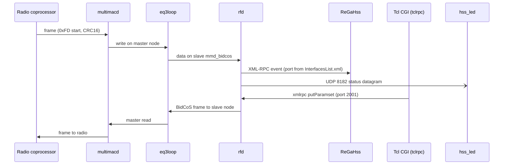
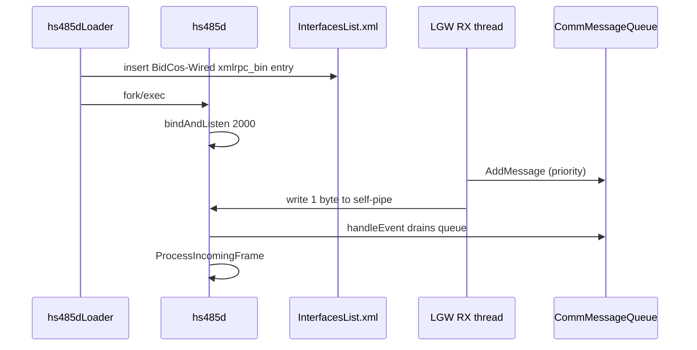

# Integration Seams

Scope: seam files supplied by the coordinator for OpenCCU-Base (C/C++ daemons, one Linux kernel module, Tcl/CGI layer).
Status legend: READ = file read in full or in the relevant region; GREP = only grep-sampled; NOT-READ = not opened (turn limit).

## Summary

| Seam type (as labelled) | Real mechanism found | Verdict |
|---|---|---|
| msmq | In-process `CommMessageQueue` (pthread mutex + condvar) plus a self-pipe. No System V / POSIX / MSMQ message queue exists. | False positive for OS-level MQ; real in-process queue |
| ipc | (a) kernel char-device loopback with ioctl API; (b) AF_UNIX SOCK_SEQPACKET control socket in hss_led; (c) loopback UDP 8182 status datagrams; (d) fork/exec supervisor; (e) pid/status marker files | Real, several distinct IPC channels |
| tcl-load | Tcl `load`-style extension `tclrpc` exposing `xmlrpc` command; `list_values.tcl` is a standalone dev tool using `package require tdom` | Partly real (tclrpc), mostly false positive for listed C++ files |
| xmlrpc | libXmlRpc server in hs485d and rfd; XmlRpc client in HSSManager, hss_led, SetInterfaceClock, tclrpc | Real, the primary service API toward ReGaHss and WebUI |

## 1. "msmq": HS485 receive queue (in-process only)

Files: `src/hs485d/HS485Controller.h`, `src/hs485d/HS485ControllerCCU1.h` (READ), `src/libhsscomm/CommMessageQueue.cpp` (READ).

- No `msgget/msgsnd/mq_open/ftok` anywhere in the two headers (grep returned nothing). There is no OS message queue.
- `HS485Controller.h:141` declares `CommMessageQueue rxq;` ("Empfangswarteschlange") and `HS485Controller.h:143` a `pipe_fds[2]`.
- `CommMessageQueue` (`libhsscomm/CommMessageQueue.cpp:23-125`): priority-ordered `std::list<CommMessage*>` guarded by `pthread_mutex_t`, `pthread_cond_t`; `AddMessage` (l.41) inserts by `GetPriority()`, `WaitNextMessage` (l.79) does timed condvar wait. Messages are heap objects, ownership passes to the consumer (`delete msg` in `HS485Controller::handleEvent`).
- Producer side: the CommController RX thread calls `HS485Controller::ProcessReceivedMessage` (`HS485Controller.cpp:61-71`): `rxq.AddMessage(msg)` then writes 1 byte to `pipe_fds[1]` to wake the XmlRpc dispatcher (self-pipe trick). Consumer side: `HS485Controller::handleEvent` (`HS485Controller.cpp:129-150`) reads the pipe and drains `rxq`, calling `HS485Manager::GetSingleton()->ProcessIncomingFrame(frame)`. `hs485d.cpp:407` registers the controller as an `XmlRpcDispatch` source for `ReadableEvent`.
- `HS485ControllerCCU1.h` is a thin subclass; its own queue/pipe/mutex members are commented out (l.173-177) and it reuses the base ones. `HS485ControllerCCU1::ProcessReceivedMessage` (cpp:266-276) just delegates.
- Contract: HS485 `HS485CommMessage` (frame with sender/receiver address, control char, payload) from serial/LGW reader thread to the single-threaded XML-RPC event loop. Failure modes: `write(pipe)` failure only logged (`HS485Controller.cpp:70`); wrong message type logged and dropped (l.143).
- Also: TX path uses `TxQueueAddMessage(msg)` + `WaitUntilSent` (`HS485ControllerCCU1.cpp:71-72,108-110`), response timeout constant `HS485_RESPONSE_TIMEOUT = 200` ms (cpp:22); the comment says "10ms" but value is 200.
- Observation: `HS485Controller::UpdateControlChar` copies `AddressInfo` by value (`HS485Controller.cpp:195`) and writes it back, which is consistent under mutex; no bug claimed.
- Migration risk: LOW. Replace with any thread-safe priority queue + eventfd/channel. Preserve priority ordering and the wake-up semantics into the event loop. HS485 sequence-counter logic (`CheckRxCounter`, `UpdateControlChar`) is the hard part, not the queue.

## 2. "ipc"

### 2.1 eq3loop kernel char-device loopback (READ in key regions)

File: `src/eq3_char_loop/eq3_char_loop.c` (GPL-2 kernel module, v1.6, l.1157). Peer: `src/multimacd/UpstreamCharConnection.cpp` (master), rfd / HMIPServer (slaves). Test: `src/eq3_char_loop/test/eq3loop_restart_test.c`.

- Control node `/dev/eq3loop` plus 4 channels (`EQ3LOOP_NUMBER_OF_CHANNELS`, l.45). Master opens `/dev/eq3loop` (O_RDWR|O_NONBLOCK), issues `EQ3LOOP_IOCSCREATESLAVE` (`_IOW('L',1,uint32_t)`, l.51) with a name string; the driver then creates `/dev/<name>` via `device_create` (l.~935). Slave (e.g. `mmd_bidcos`, `ttyS0` per `multimacd.conf:18-20`) opens that node like a tty.
- Master ioctl `EQ3LOOP_IOCGEVENTS` (`_IOR('L',2,...)`, l.52) returns bitmask: bit0 SLAVE_OPENED, bit1 SLAVE_CLOSED, bit15 slave state open (l.54-56, 470-515). multimacd polls the master fd (`UpstreamCharConnection.cpp:~150-190`, POLLIN|POLLPRI|POLLERR|POLLHUP, 5000 ms) and on events calls `UpstreamConnect/UpstreamDisconnect`.
- Slave side emulates a serial port: handles termios get/set, termios2, `TIOCINQ/OUTQ/MGET/SERGETLSR/GICOUNT`, `TCFLSH`, `TIOCEXCL` (l.~530-650). Modem lines are faked (`TIOCM_DSR|CD|CTS`). Unhandled ioctls return `-ENOTTY` and log via printk.
- Buffers: two 1024-byte circ_bufs per channel (`BUFSIZE`, l.58), one semaphore per channel, wait queues master2slave/slave2master.
- Lifetime rule: `generation` counter (l.82-84, 160-170 comment): when a master closes, all its slave connections are hung up permanently (`-ENODEV`); slave must reopen. Verified by `eq3loop_restart_test.c`.
- Single slave per channel: second open returns `-EBUSY`.
- Kernel-version shims: `access_ok` signature (<5.0), `class_create` (<6.4), `no_llseek/noop_llseek` (6.12), `.ioctl` (<2.6.11).
- The ioctl numbers and event bits are duplicated (not shared header) in `UpstreamCharConnection.cpp:33-36` and the test file. Any change must be mirrored by hand.
- Migration risk: HIGH if kernel module must be kept (out-of-tree module, per-kernel build, tty semantics); MEDIUM if replaced by a pty pair or socketpair/UNIX sockets in multimacd, but then rfd/HMIPServer (RXTX, Java) expect a tty device path and termios ioctls. Not replaceable without changing the slave consumers. Dual-protocol doc: `src/eq3_char_loop/Dual_Protocol_Linux_Drivers.pdf` (not read). Sibling `mxs_raw_auart.c` and `src/bcm2835_raw_uart` not analysed.

### 2.2 hss_led control socket and status feed (READ)

Files: `src/hss_led/LedController.cpp`, `LedProtocol.h`, `StatusCommand.h`, `hss_led.cpp`, `UdpCannel.cpp`, `defines.h`, `InfoLed.cpp` (partial), `Network.cpp` (grep).

- Control socket: `AF_UNIX`, `SOCK_SEQPACKET`, path `/run/hss_led/control` (`LedProtocol.h:13`, `LedController.cpp:456-475`). One request / one reply per connection; messages <512 bytes, text protocol version prefix `"1 "` with verbs `status`, `report`, `system`, `override`, `release`, `auto`, `led <name> ...`, `list` (`LedController.cpp:~395-430, 540-553`). Reply starts `OK` or `ERR ...`.
- Auth: socket mode 0660, chown to group `status` (l.471-473); `SO_PEERCRED` uid captured on accept (l.563); `report` allowed for root or user `hssled`, everything else root only (dispatch, l.~405-420). Max 32 clients, 1 s deadline each.
- Client: same binary invoked as `hss_ledctl` or `hss_led --led-control` (`hss_led.cpp:~52-56`), `LedProtocol::request` with 2000 ms timeout (`LedController.cpp` client()).
- Persistence: `/run/hss_led/state` written atomically via tmp+rename (l.396-409); lock file `/run/hss_led/lock` with `flock`.
- Inputs from the platform via files: `/var/status/startupFinished`, `/var/status/hssLedReady`, `/etc/config/disableLED`, `/sys/class/leds` (l.28-31), `/usr/local/HMLGW`.
- Status feed (UDP): `HSSManager::SendUDPInfo` (`libhsscomm/HSSManager.cpp:69-92`) sends datagrams `"<task_id>\n<KEY>=<value>\n"` to 127.0.0.1:8182; `hss_led` binds that port (`UdpCannel.cpp:45-61`, `defines.h:14 ERR_PORT=8182`) and parses in `Info*/MessageParser`. Senders: rfd and hs485d via `HSSManager` subclasses (`rfd/RFManager.cpp`, `hs485d/HS485Manager.cpp`). Datagrams are lossy and unauthenticated (any local process can send).
- Process liveness check by pid files: `/var/run/eq3configd.pid`, `/var/run/ReGaHss.pid`, `/var/run/ssdpd.pid`, `/var/run/HMIPServer.pid`, `/var/run/multimacd.pid`, `/var/run/rfd.pid` (`InfoLed.cpp:212-220`).
- Subprocess: `runStatusCommand` (`StatusCommand.h`) uses `posix_spawn` of `/bin/sh -c` with cleared signal mask; used for `/bin/checkInternet` (`Network.cpp:60`).
- Reverse: `www/config/cp_security.cgi:572` does `exec killall hss_led` (Tcl CGI restarting the daemon by name); `www/api/methods/ccu/getinfoledconfig.tcl`, `www/api/methods/ccu/setinfoledconfig.tcl` read/write the config file hss_led evaluates.
- Cross-call: `RFLGWInfoLED::setLED` makes an XML-RPC call `setRFLGWInfoLED` to rfd at `http://127.0.0.1:<port>` (`RFLGWInfoLED.cpp:48-75`), port from `/etc/rfd.port` (fallback "2001").
- Migration risk: MEDIUM. Text protocol is small and self-contained and has tests (`src/hss_led/tests`); port-8182 UDP and pid-file coupling to other daemons is implicit and must be preserved or replaced on both ends.

### 2.3 hs485dLoader to hs485d (fork/exec supervisor) (READ)

- `hs485dLoader.cpp:134-170`: loops `fork()` then `execl("/bin/hs485d", ..., "-g","-i",<id>,"-f",<conf>)`, `wait()` and restart until child exit status equals `EACCES` or `ENOEXEC` (the check is on `retVal`, which in the parent is reset to 0 each iteration, so the stated termination condition is effectively never met in the parent; observation, not verified at runtime). Writes `/var/run/hs485dLoader.pid`.
- hs485d exit code 2 is the documented signal "important, hs485dLoader checks that" (`hs485d.cpp:277`), but the loader code shown does not read the child's exit status. Observation only.
- File contract: reads `/etc/config/hs485d.conf` (PropertyMap sections `Interface N`, key `Type=HMWLGW`), edits `/etc/config/InterfacesList.xml` in place with tmp/bak/rename (`hs485dLoader.cpp:213-298`), reading port from `/etc/hs485d.port` (default 2000). The inserted entry is `<ipc><name>BidCos-Wired</name><url>xmlrpc_bin://127.0.0.1:<port></url><info>BidCoS-Wired</info></ipc>` (l.238-240). This is the registration contract with ReGaHss (closed binary, not in this repo).
- `hs485d.cpp` side: PID file `/var/hs485d.pid` (l.16), connstat file `/var/status/<serial>.connstat` (l.287-293, also `LGWPortWrapper.cpp:228-236`, content = status text; WebUI checks existence), UDS_PATH constant `/var/socket_hs485d` (l.17) but the `serverProxy.bindAndListen(UDS_PATH)` is commented out (l.399-402), so no Unix socket is exposed.
- Migration risk: MEDIUM (config-file and `xmlrpc_bin://` URL formats are the contract with an external closed binary). Note scheme `xmlrpc_bin` means binary-RPC while hs485d serves XML-RPC; hs485d's `XmlRpcServer` bound on TCP (see section 4). Unverified how ReGaHss selects the protocol.

### 2.4 LAN gateway link (hs485d to HMW-LGW) (partly read)

- `LGWPortWrapper.cpp` (READ) wraps `ulc::UnifiedLanCommController` (TCP, port 1000, optional AES-style encryption key = MD5 of password, `hs485d.cpp:116-127,282-283`). Reconnect: discovery via `LDU::LanDeviceUtils::searchDeviceBySerial`/`readRuntimeNetworkConfiguration` with back-off 5 s up to ~65 s (`LGWPortWrapper.cpp:161-212`). Note `reconnect()` calls are commented out in `ReadData/SendData` (l.62,87-88): reconnection is not triggered from those paths in this file.
- Device discovery: `searchDeviceByTypeAndSerial("eQ3-HMW-LGW*", ...)` (`hs485d.cpp:506`). The discovery protocol (`EQ3ConfigProtocol.h`, UDP broadcast framing in `eq3configd/src/udpframe.cpp`) was NOT READ.
- `src/libLanDeviceUtils/include/IPConfiguration.h` (GREP only): a value class for IP settings; not an IPC mechanism itself (matched "IPC" by substring of "IPConfiguration").

## 3. "tcl-load"

- `src/tclrpc/tclrpc.cpp` (READ partial): Tcl extension. `Tclrpc_Init` (l.64) registers command `xmlrpc`, package `xmlrpc` (`Tcl_PkgProvide`), converts between Tcl strings and `XmlRpcValue` (`StringToXmlRpcValue` l.90, `StringFromXmlRpcValue` l.193), forces ISO-8859-1 because "rega can only handle iso-8859-1" (l.72-74). Holds one global `XmlRpcClient*` (l.56). Loaded from Tcl via `load`; load sites found: `src/tcl_homematic/src/tclload.tcl`, `usr/lib/tcl8.2/homematic/homematic.tcl`, and many WebUI CGI/Tcl files (`www/config/*.cgi`, `www/api/backup/common.tcl`, `www/tools/devconfig.cgi`, `src/webui/rega/bin/hm_autoconf`) matching the load/package-require grep. The exact `load` line per file was not inspected (grep counts only).
- `src/devicetypes/list_values.tcl` (READ partial): standalone `#!/usr/bin/tclsh` build/dev helper, `package require tdom`, parses device-type XML and builds a translation key table (`read_translations`/`write_translations`, `add_value`). Not a runtime seam.
- NOT READ (labelled tcl-load by the heuristic but contents unknown): `src/eq3configd/main.cpp`, `src/eq3configd/src/udpframe.cpp`, `src/libLanDeviceUtils/src/EQ3ConfigProtocol.h`, `src/hs485d/HMWLGWCommand.h`, `HMWLGWTransportFrame.h`, `HMWLGWTransportFrame.cpp`, `HS485CommMessageLGW.h`, `HS485ControllerLGW.cpp`. From names and the `hs485d.cpp` usage they are the HMW-LGW wire protocol (transport framing, commands) and the UDP config/discovery protocol of `eq3configd`; probably not Tcl loading. Needs a follow-up pass.
- Related: `src/tclrega`, `src/tclticks`, `src/tcl_homematic` are other Tcl extensions (directory listing only).
- Migration risk: MEDIUM-HIGH for `tclrpc`: the Tcl scripts in `www/` depend on the `xmlrpc` command semantics (string typing rules, latin-1). Any replacement must keep the Tcl-facing API or rewrite all CGI callers.

## 4. "xmlrpc"

Library: `src/libXmlRpc/src` (12 files), consumers in hs485d (5), rfd (11), libhsscomm (14), hss_led (1), tclrpc (1), SetInterfaceClock (1).

### 4.1 hs485d server (READ)
- `hs485d.cpp:70-71,388-407`: `XmlRpcServer s`; `InitXmlRpcMethods(s)`; `s.bindAndListen(port, 100)` (default `LISTEN_PORT_XML = 2000`, l.19; overridable by `Listen IP` / `Listen Port` in `hs485d.conf` for LGW mode, l.462-469); introspection enabled; main loop `s.work(timeout)` interleaved with `TimerTarget::s_timerQueue` (l.418-426). Single-threaded event loop; serial/LGW RX thread hands over through the self-pipe (section 1).
- Methods registered (`hs485d/XmlRpcMethods.cpp:608-632`): getParamsetDescription, putParamset, getParamset, getValue, setValue, listDevices, searchDevices, getDeviceDescription, getLinkPeers, getLinks, addLink, setLinkInfo, getLinkInfo, getParamsetId, removeLink, init, updateFirmware, deleteDevice, reportValueUsage, clearConfigCache, logLevel, replaceDevice, listReplaceableDevices, getLGWStatus, ping. `activateLinkParamset` is defined but commented out of registration (l.619).
- `init(url, id[, no_callback])` registers the caller as an event sink (`HSSManager::PlatformInit`, `libhsscomm/HSSManager.cpp`), then pushes `newDevices`/`deleteDevices`/`replaceDevice` callbacks to the caller.
- Errors use `XmlRpcException(msg, code)` (e.g. code -3 "Unknown paramset", `HS485Channel.cpp:35`).

### 4.2 Event/callback client side in libhsscomm (READ)
- `HSSManager::ReportEvent` fans out `event` calls to every registered handler via `HSSXmlRpcEventDispatcher` (one per URL), drops unreachable ones and persists the list (`SaveXmlRpcHandlers`) (`HSSManager.cpp:~104-145`). `XmlRpcCallAsync` uses `AsyncXmlRpcSender`, optional `system.multicall` batching (`StoreMulticall`). `XmlRpcCallSync` for `listDevices`, `system.listMethods`, etc.
- Handler list persisted to a file (`xmlrpcHandlersFilepath`, set at init; exact path not read).

### 4.3 rfd server
- `rfd/XmlRpcMethods.cpp:1075` registers `setInterfaceClock(int utcSeconds, int offsetMinutes)` which calls `RFManager::SetInterfaceClock`; also `getVersion`, `updateFirmware`, `replaceDevice` etc. (only sampled). Default rfd port 2001, taken from `/etc/rfd.port`.

### 4.4 Small clients
- `SetInterfaceClock/SetInterfaceClock.cpp` (READ): one-shot CLI; url from argv[1] or `127.0.0.1:<port from /etc/rfd.port, default 2001>`; sends `setInterfaceClock(utcSeconds, utcOffsetMinutes)` with `TimeZoneInfo::GetUTCOffset()/60`; exit 0 ok, 2 on fault/transport error, 1 on bad usage. The ints are cast to `int` (32-bit epoch, year-2038 limit). Usage text calls the method `SetInterfaceClock` with capital S but the call uses lower-case (l.61).
- `hss_led/RFLGWInfoLED.cpp:48-75`: `setRFLGWInfoLED(int 0..3)` to rfd.
- `tclrpc` (section 3): generic client for WebUI scripts.
- Not covered: XML-RPC users inside `src/rfd` internals beyond the above, `src/libeq3config/CCU2CommControllerMod`, `src/webui` Tcl callers, and the closed ReGaHss (it is the main consumer, registering via `init`).

### 4.5 HS485 channel/central/controller files (GREP)
`HS485Central.cpp`, `HS485Channel*.cpp`, `HS485Channel*.h`, `HS485Controller*.cpp`, `HS485Controller*.h` use `XmlRpc::XmlRpcValue` and `XmlRpcException` as the in-memory data model for paramsets and values (e.g. `HS485Channel.cpp:30-110`, `HS485Central.cpp:129-142`). XML-RPC types are therefore deeply embedded in the domain layer, not confined to the transport edge. `HS485Controller` itself inherits `XmlRpc::XmlRpcSource` (`HS485Controller.h:25`) to join the dispatcher.

### 4.6 Migration risk
HIGH. The XML-RPC surface (method names, struct keys such as `ADDRESS`, `VERSION`, `PARAMSETS`; `init`/callback handshake; `system.multicall`; introspection) is the compatibility contract with ReGaHss, WebUI and third-party integrations (the related repository `/home/standard/dev/OpenCCU` was not analysed). A re-implementation must keep wire-level behaviour, including the latin-1 constraint on the Tcl side and the persistent handler list.

## Coverage and gaps
- READ: HS485Controller.{h,cpp}, HS485ControllerCCU1.{h,cpp}, hs485d.cpp, LGWPortWrapper.cpp, hs485dLoader.cpp, SetInterfaceClock.cpp, LedController.cpp (most), eq3_char_loop.c (control, ioctl, open, init), CommMessageQueue.cpp, HSSManager.cpp (first ~330 lines), tclrpc.cpp (head), XmlRpcMethods.cpp (registration, a few methods).
- GREP only: IPConfiguration.h, rest of hss_led, rfd XML-RPC methods, load sites in www/ and etc/.
- NOT READ: eq3configd/main.cpp, eq3configd/src/udpframe.cpp, EQ3ConfigProtocol.h, HMWLGWCommand.h, HMWLGWTransportFrame.{h,cpp}, HS485CommMessageLGW.h, HS485ControllerLGW.cpp, devicetypes/list_values.tcl (tail), mxs_raw_auart.c, bcm2835_raw_uart.

## Sequence Diagrams

### Radio event and configuration write

### hs485d startup and in-process queue

