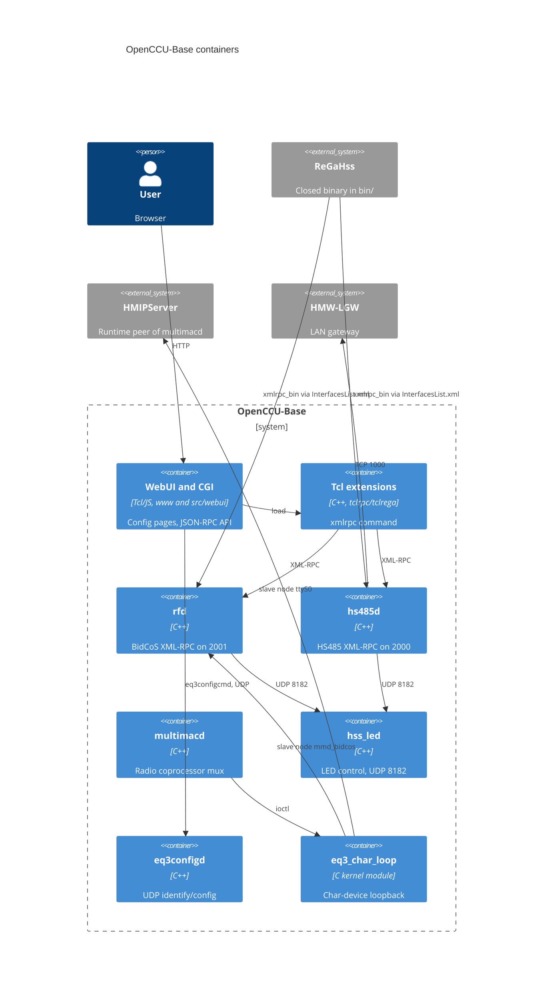

# Stack Inventory
| Stack | Dirs | Language | Notes |
|---|---|---|---|
| root | . | make/cmake | |
| .github | .github | YAML | CI |
| bin | bin | binaries | prebuilt |
| build-tools | build-tools | script | |
| cmake | cmake | CMake | |
| etc | etc | conf | |
| firmware | firmware | XML/hex | |
| licenses | licenses | txt | |
| opt | opt | FTL | |
| src | src | C++/Tcl/JS | split: native, webui+devicetypes+tcl |
| tests | tests | XML/sh/py | |
| usr | usr | Tcl | |
| www | www | Tcl/JS | split: config, rest |
Integration seams: msmq (HS485Controller*), ipc (hs485d, eq3_char_loop, hss_led, libLanDeviceUtils), tcl-load (devicetypes, eq3configd, hs485d), xmlrpc (SetInterfaceClock, hs485d, ...).
Related repo [src-001] `/home/standard/dev/OpenCCU`: scope hint only.

## Architecture Overview

