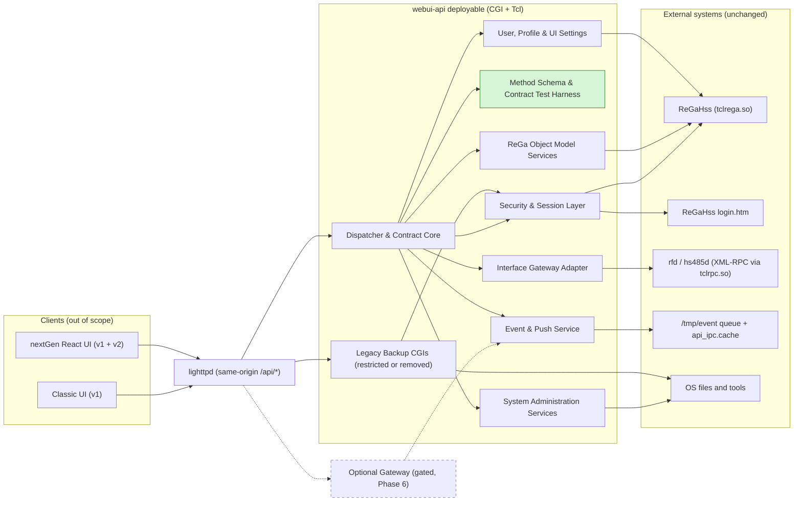

# Component Diagram — webui-api (Target)

**What's shown**: Target containers and components of the API deployable, their bridges to unchanged external systems, and the optional gated gateway.

**Architectural style**: Refactor in place (modular monolith internals)

**Key decisions reflected**: Q2, Q3, Q4, Q6, Q7, Q8, AQ3, AQ5, AQ6

## Legend

- Solid arrows: synchronous calls (CGI, in-process Tcl, XML-RPC, rega_script, file I/O)
- Dashed arrows and dashed box: optional, evidence-gated gateway path
- Green: new component (no legacy spec)
- Clients are outside the feature scope

## Differences from Current State

- New internal layer boundaries; all privilege/validation flows through Security & Session Layer and the schema harness
- Backup CGIs removed or restricted; `www/api` duplicate removed
- New v2 surface (batch, bulk model, edit endpoints, profile, events) and optional gateway
- External systems and ports unchanged

## Design Rationale

Single deployable fits the small device (Q2, AQ3, Q8); per-integration adapters isolate escaping and error mapping (AQ5); same-origin keeps CORS closed (AQ6); gateway deferred until measured (Q2, Q7). See ADR decisions Q2, Q6, Q7, AQ3, AQ5, AQ6.
