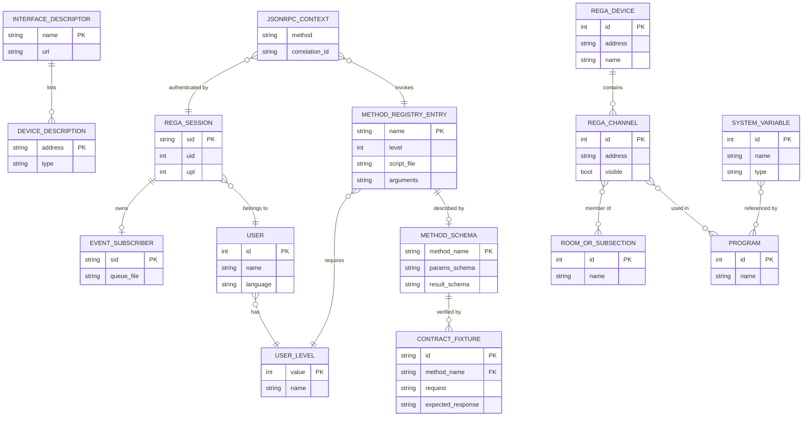

# Entity Diagram — webui-api Domain Model (Target)

**What's shown**: Core API entities from the analysis plus the new schema/fixture entities; storage stays in ReGa, files and the event queue (no new database).

**Architectural style**: Refactor in place (modular monolith internals)

**Key decisions reflected**: Q4, Q6, Q12 (auto-selected), Q14 (auto-selected)

## Legend

- `METHOD_SCHEMA` and `CONTRACT_FIXTURE` are new (data files / tests, not database tables)
- All other entities are existing and owned by ReGaHss, interface daemons, config files or the event queue; no DB schema changes

## Differences from Current State

- Adds method schema and golden fixtures as first-class contract artifacts
- Adds `correlation_id` to the request context
- Entities and relationships otherwise unchanged

## Design Rationale

No schema change per Q4 (keep current). Schema and fixtures make the contract machine-checkable (Q12/Q14 auto-selected; ADR CQ1).
