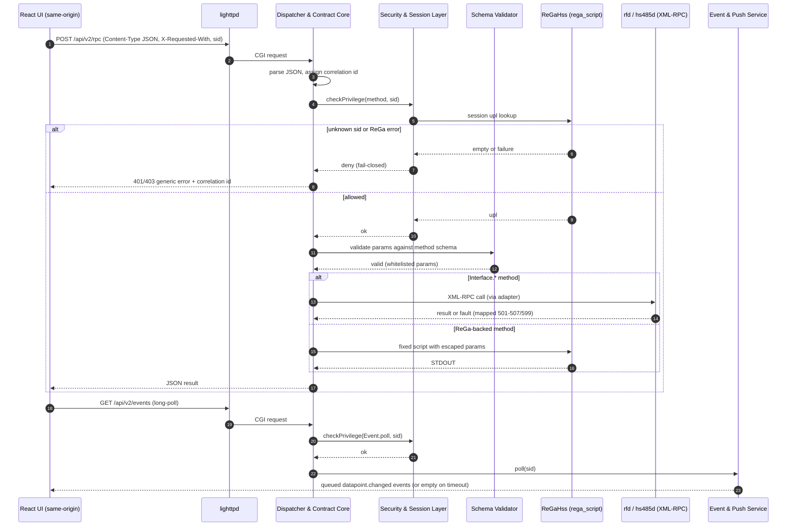

# Sequence Diagram — Hardened v2 Request and Push Subscription (Target)

**What's shown**: A strict-mode v2 call from the React UI through the hardened dispatcher to ReGa and an interface daemon, followed by event long-poll delivery.

**Architectural style**: Refactor in place (modular monolith internals)

**Key decisions reflected**: Q3, Q6, Q7, AQ5, AQ6

## Legend

- `alt` blocks: fail-closed denial versus allowed path
- Interface adapter and rega_script calls are the anti-corruption points (AQ5)

## Differences from Current State

- Strict Content-Type + CSRF header, correlation id, schema-driven param whitelist (v1: any param becomes an injected variable)
- Errors are generic with real HTTP status in v2 (v1: HTTP 200 with `errorInfo`)
- Event producers are real; polling is long-poll with fixed lock/overflow behaviour

## Design Rationale

Privilege check first and fail-closed (Q6, ADR Q6); one serializer and sanitised errors (Q7 logging); long-poll via CGI first, SSE via gateway only if gated in (Q3, Q2).
