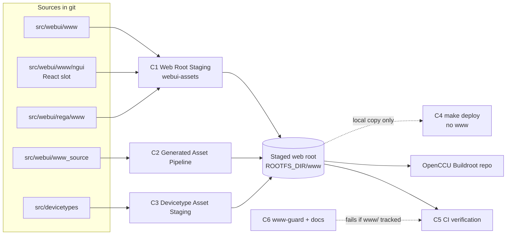

# Component Diagram

**What's shown**: Components that produce and guard the staged web root after www/ is removed
**Architectural style**: Keep current architecture (refactor in place)
**Key decisions reflected**: Q2, Q-DEPLOY, Q-GUARD, Q-REACT

**Legend**: solid arrow = build-time copy or generation; dotted = checks or optional flow.

## Differences from Current State

Repo-level `www/` is no longer part of the picture; `make deploy` stops writing the web root; a guard and an `ngui` slot are added.

## Design Rationale

Single source for both UIs (Q2). Guard is a CI step (Q-GUARD). The `ngui` slot reuses the existing copy step (Q-REACT).
