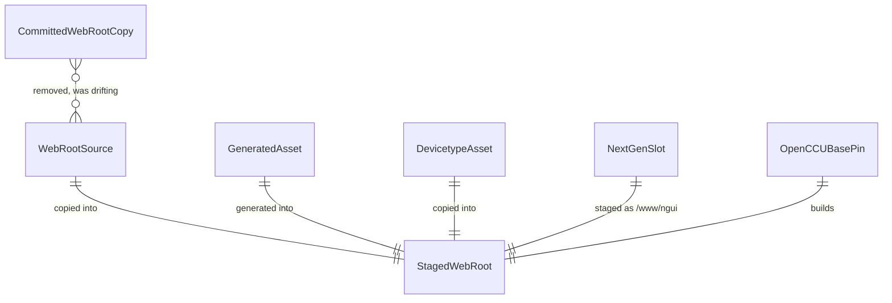

# Entity Diagram

**What's shown**: Entities involved in the consolidation
**Architectural style**: Keep current architecture (refactor in place)
**Key decisions reflected**: Q2

**Legend**: CommittedWebRootCopy is the entity being retired.

## Differences from Current State

Adds DevicetypeAsset and NextGenSlot; CommittedWebRootCopy is removed.

## Design Rationale

Every staged file has exactly one source owner after the cutover.
