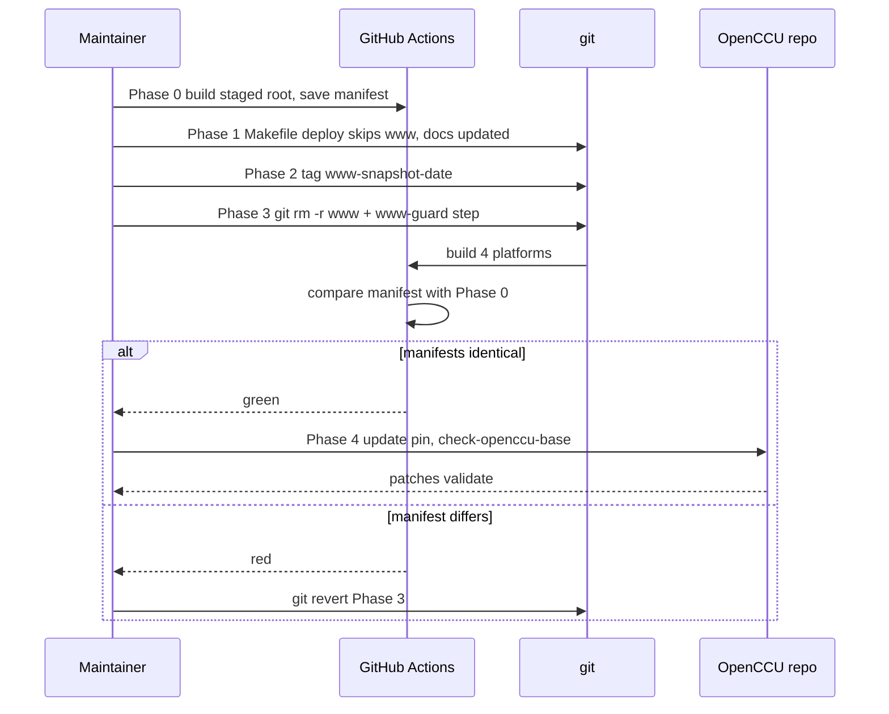

# Sequence Diagram

**What's shown**: Cutover sequence from verification to sibling pin bump
**Architectural style**: Keep current architecture (refactor in place)
**Key decisions reflected**: Q-GUARD, Q-DEPLOY

**Legend**: alt/else = pass or rollback path.

## Differences from Current State

The cutover itself is new; today there is no verification or guard.

## Design Rationale

Manifest proof gates the irreversible-in-practice step; rollback is a single revert.
