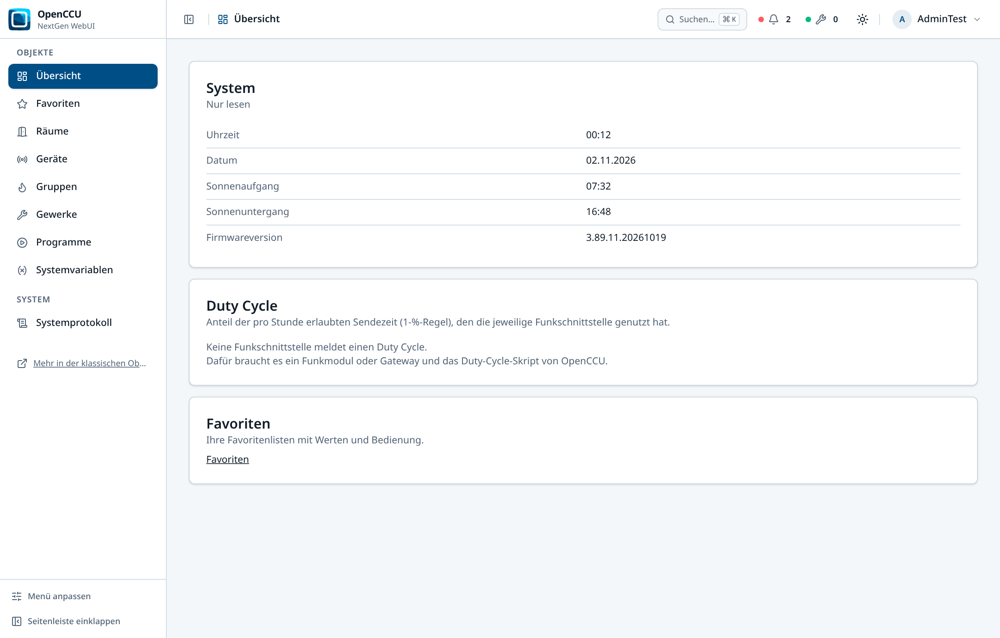
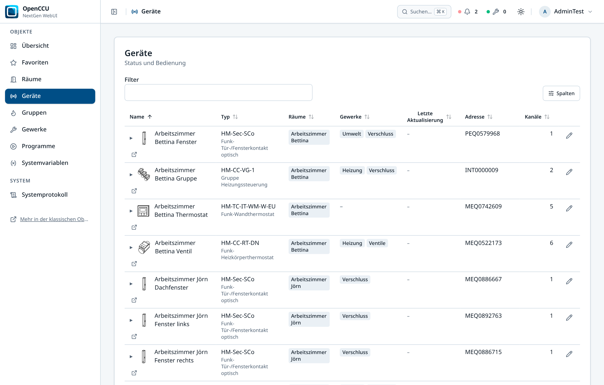
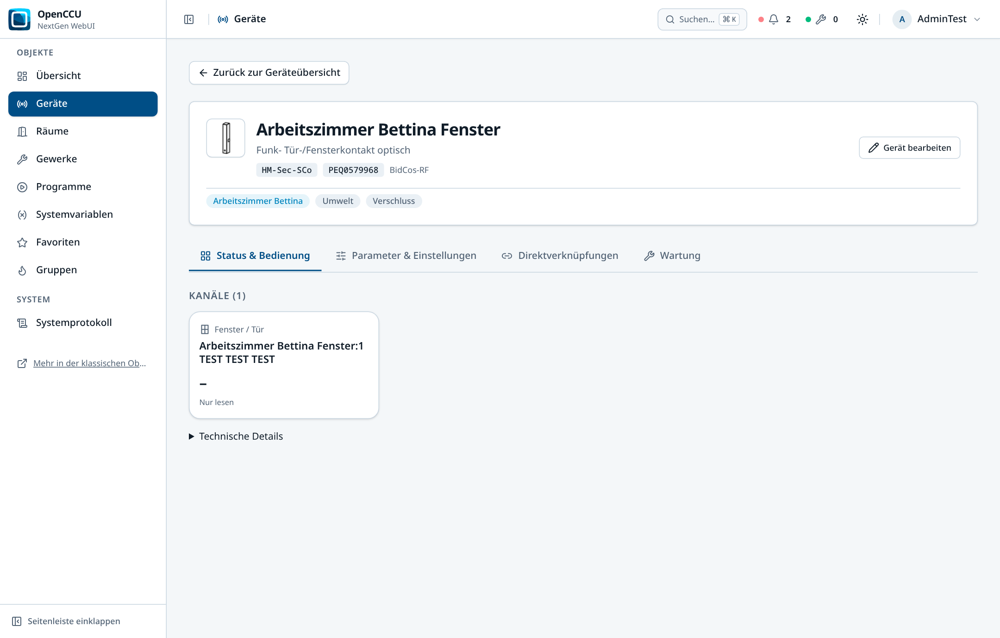
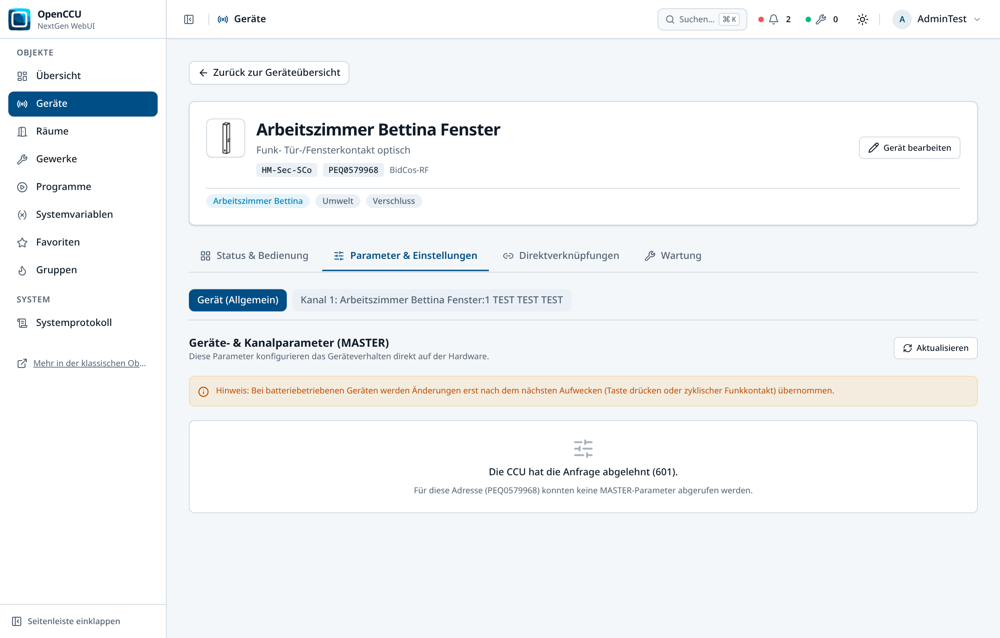
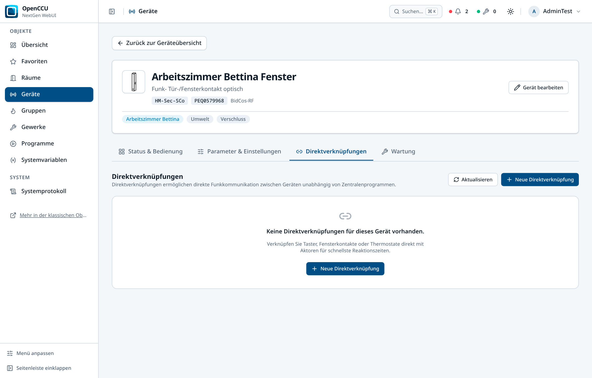
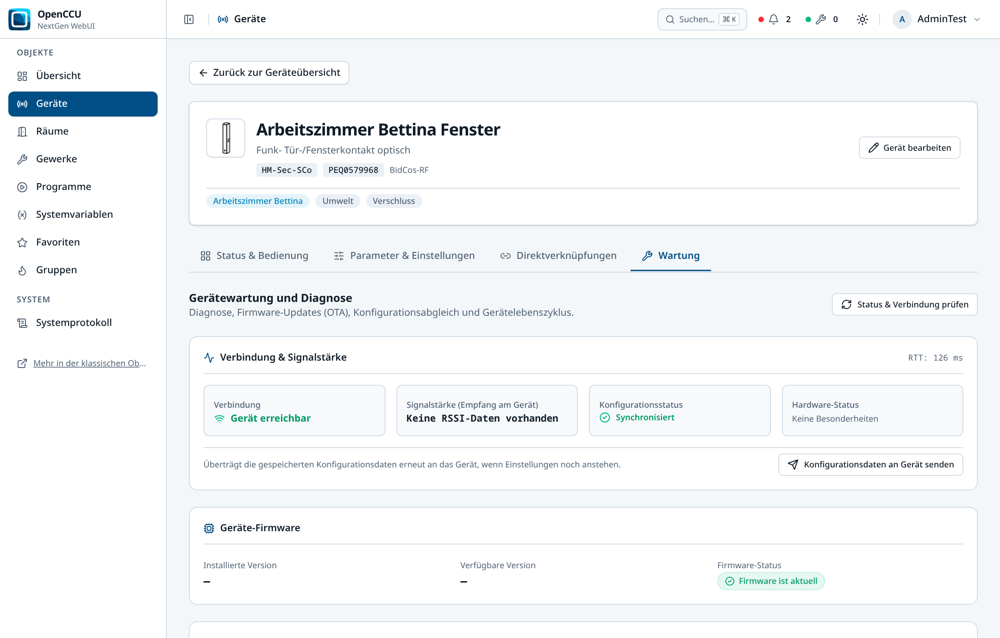
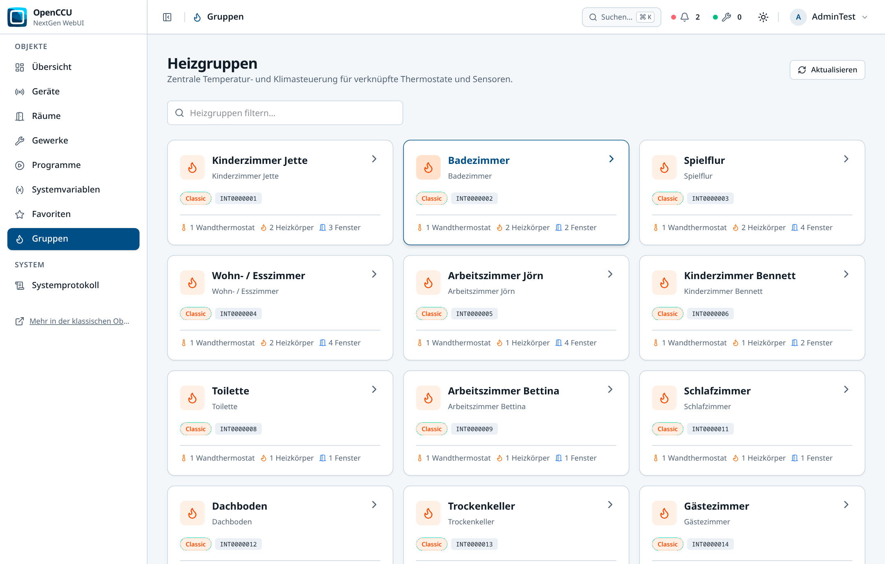
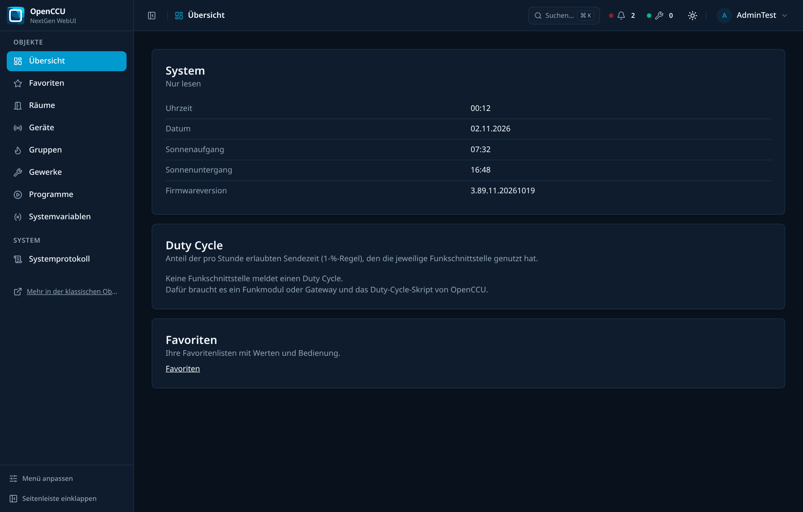

# OpenCCU-Base & NextGen WebUI

[](https://github.com/jhoos70/nextgen-ui/releases)
[](licenses/licenses.md)
[](https://www.typescriptlang.org/)
[](https://react.dev/)
[](https://tailwindcss.com/)

A modern, fast, mobile-friendly **NextGen WebUI** for CCU3, RaspberryMatic, and OpenCCU smart-home hubs—running side-by-side with the classic WebUI without modifying legacy files.

This repository serves as both the home of the **OpenCCU NextGen WebUI** and the foundational **OpenCCU-Base runtime** (core daemons, libraries, and firmware assets).

---

## 🌟 NextGen WebUI Showcase

### Modern Dashboard Overview
A clean, responsive landing page displaying CCU system health, real-time duty cycle gauges, carrier sense monitoring, and live astro data (sunrise/sunset).



---

### Key Features & Capabilities

| Feature | Description | Screenshot |
| :--- | :--- | :--- |
| **Object-Centric Device Management** | All device aspects united in one place: live status & controls, channel overview, parameters, direct links, and diagnostics. |  |
| **Interactive Live Control** | Direct feedback tiles for dimmers, shutters, switches, thermostats, and window sensors with real-time feedback and confirmation status. |  |
| **Configuration Parameters (MASTER)** | Full device parameter configuration directly from the device view, eliminating the need to navigate between separate menus. |  |
| **Direct Links (Direktverknüpfungen)** | Inspect and manage direct device peerings, link descriptions, sender/receiver channels, and configuration profiles. |  |
| **Maintenance & RF RSSI Diagnostics** | Live signal quality metrics (RSSI dBm, rating), unreach/lowbat indicators, firmware versions, and communication error status. |  |
| **Heating Groups (Heizungsgruppen)** | Comprehensive management of virtual heating groups: view members (thermostats, wall controls, window sensors), setpoints, and profiles. |  |
| **Responsive & Dark Mode Ready** | Fully accessible UI built on Radix primitives and Tailwind CSS, designed for mobile phones, tablets, and desktop workstations. |  |

---

## 🚀 Quick Start: Install on Your CCU

You can install and test the NextGen WebUI on any CCU3, RaspberryMatic, or OpenCCU instance without risking system stability. It runs as an independent CCU Add-on and does not replace or modify your classic WebUI.

1. Download the latest `openccu-nextgen-addon-*.tar.gz` from the [Releases page](https://github.com/jhoos70/nextgen-ui/releases).
2. In your CCU WebUI, navigate to **Settings** → **Control Panel** → **Additional Software** (*Einstellungen → Systemsteuerung → Zusatzsoftware*).
3. Choose the downloaded `.tar.gz` archive and click **Install** (*Installieren*).
4. After automatic installation (and automatic service restart), access the NextGen WebUI at:
   ```text
   http://<your-ccu-ip>/addons/nextgen/
   ```
5. Log in with your standard CCU user credentials. Your session is shared between the NextGen WebUI and the classic WebUI.

---

## 🛠️ Architecture & Technology Stack

The NextGen WebUI is engineered for zero-disruption integration:

- **Frontend Core**: [React 19](https://react.dev/), [TypeScript](https://www.typescriptlang.org/), [Vite](https://vite.dev/), [Tailwind CSS v4](https://tailwindcss.com/).
- **UI Primitives**: Headless, accessible components powered by [Radix UI](https://www.radix-ui.com/) and [Lucide Icons](https://lucide.dev/).
- **API Communication**: High-performance JSON-RPC v2 backend (`/api/v2/` via `v2/model.tcl`, `v2/values.tcl`, `v2/links.tcl`, `v2/heating.tcl`), batch querying device models and live states with minimal network roundtrips.
- **Side-by-Side Coexistence**: Runs in parallel with classic WebUI (`/www/webui/next/` or `/addons/nextgen/`). Legacy files (`webui.js`, `/webui/js/lang/`, ReGa `.htm`/`.esp` scripts) remain completely untouched.
- **Future Upstream Merge**: All frontend code is strictly isolated in `src/webui/next/` and backend endpoints in `src/webui/www/api/v2/`. This ensures seamless, conflict-free rebasing and merging into upstream `OpenCCU/OpenCCU-Base`.

For technical documentation and developer guides, see [src/webui/next/README.md](src/webui/next/README.md).

---

## 📦 OpenCCU-Base: Core Runtime & Daemons

`OpenCCU-Base` provides the base source code and binary files for the major runtime components required by the OpenCCU project.

It serves as the foundational layer for core Homematic / Homematic IP services, including native daemons, shared libraries, WebUI assets, startup scripts, and configuration templates that are assembled into OpenCCU firmware and runtime environments.

### OpenCCU Project Links

- **OpenCCU GitHub Organization**: https://github.com/OpenCCU
- **OpenCCU Main Repository**: https://github.com/OpenCCU/OpenCCU
- **OpenCCU Website**: https://www.openccu.de/

### Purpose & Heritage
With the release of OpenCCU-Base, essential components of the CCU source code are openly maintained. For example, adjustments to the WebUI are significantly simplified, and modifications to core components of the CCU software from eQ-3—such as the Homematic radio and wired services—are now possible.

This repository delivers:
- Native component binaries for multiple target architectures.
- C/C++ source modules for key OpenCCU services and libraries.
- NextGen WebUI and classic WebUI resources and build assets.
- System scripts and default configuration templates.
- Additional runtime artifacts used by Homematic IP server components.

### Repository Layout

- `src/webui/next/` - **NextGen WebUI** source code (React 19, TypeScript, Tailwind).
- `src/webui/www/api/v2/` - NextGen JSON-RPC API handlers (devices, links, heating, logs).
- `src/` - source code and module-local build logic (Makefiles) for core components.
- `bin/` - architecture-specific executable binaries and helper/startup scripts.
- `src/webui/` - the classic WebUI and its Tcl-based runtime resources.
- `etc/` - configuration templates used during deployment/runtime setup.
- `opt/` - bundled server/runtime artifacts (including HMServer/HmIP related files).
- `lib/`, `usr/`, `firmware/` - additional runtime libraries and firmware-related content.

### License Information

This repository contains components under different open-source and vendor licenses:
- Main license references are available in [licenses/licenses.md](licenses/licenses.md).
- Additional bundled license texts are available in `licenses/` (e.g., `gpl-2.0.txt`, `lgpl-2.1.txt`, and `HMSL2.txt`).
